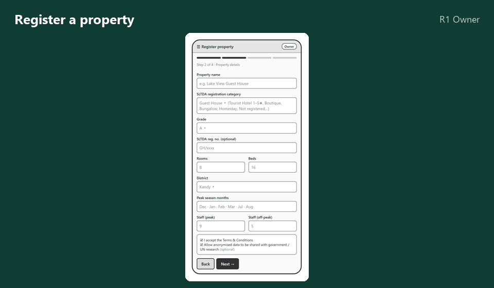
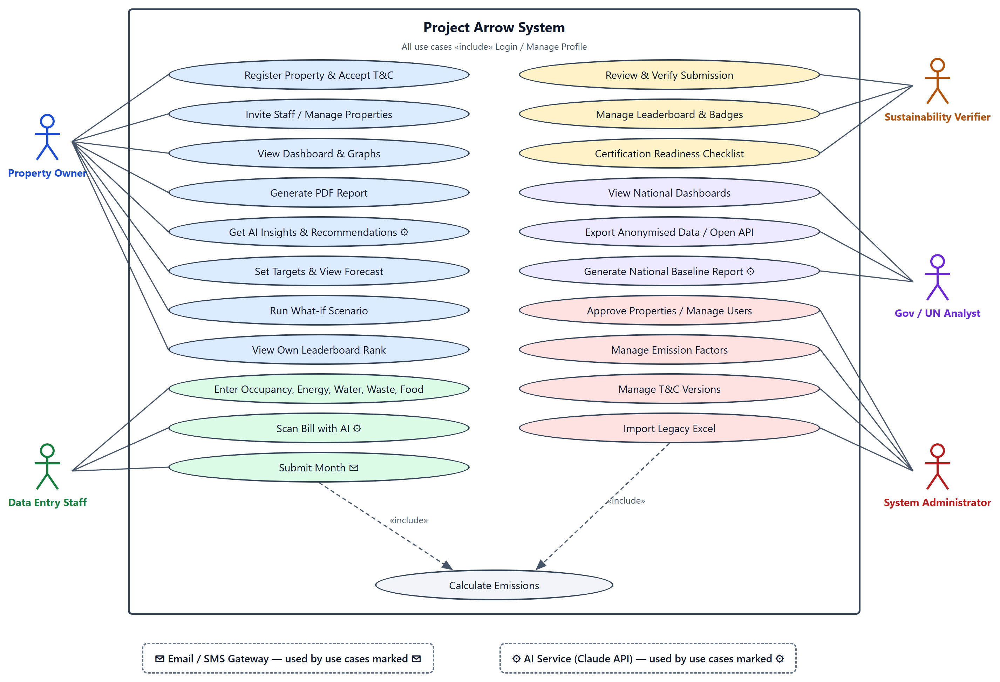
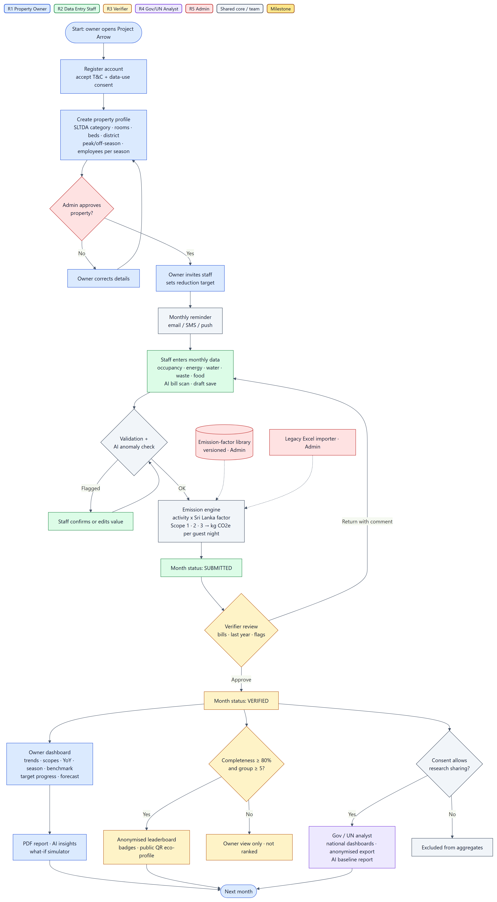
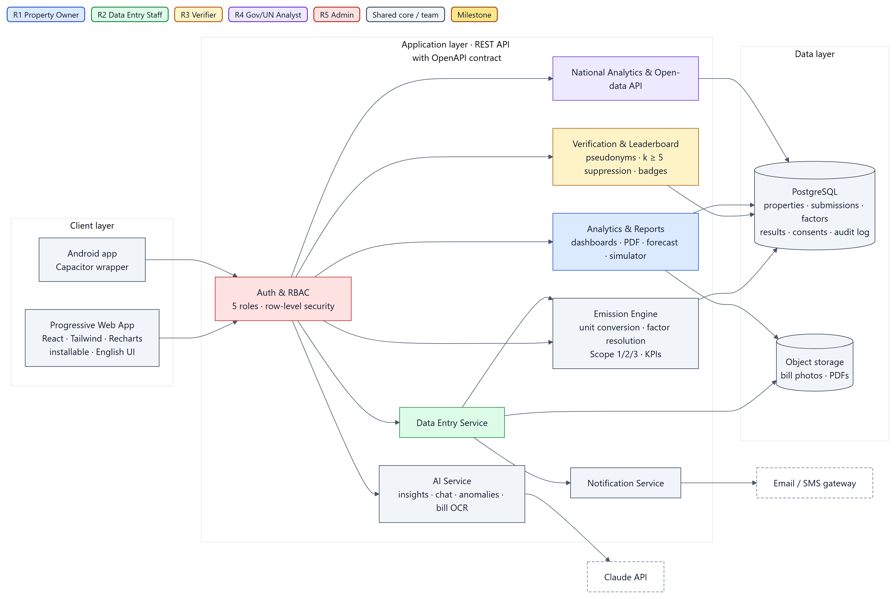
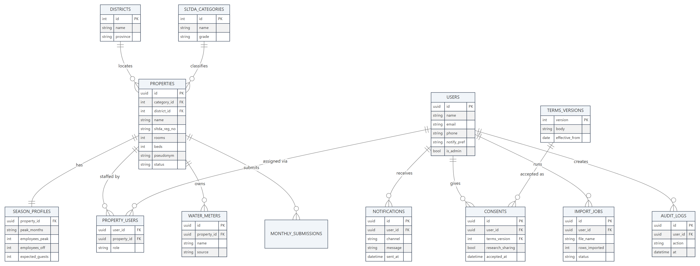
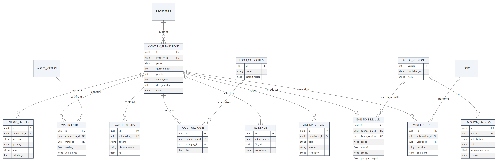
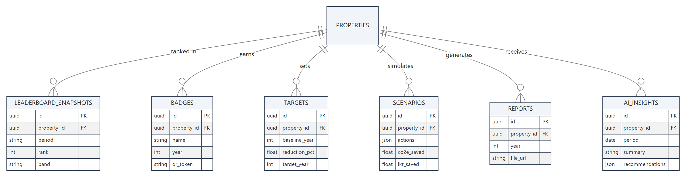
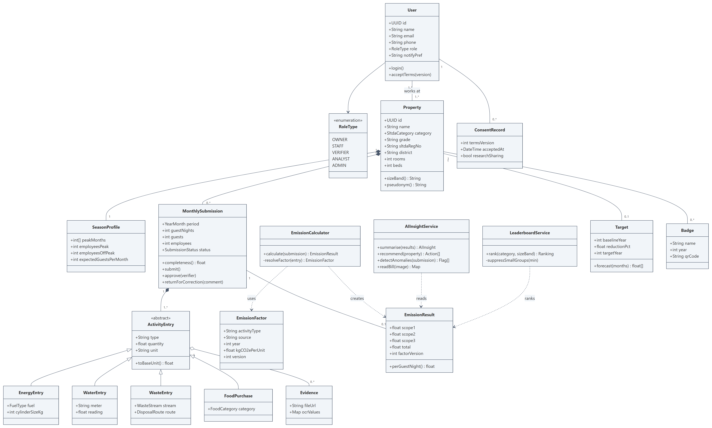
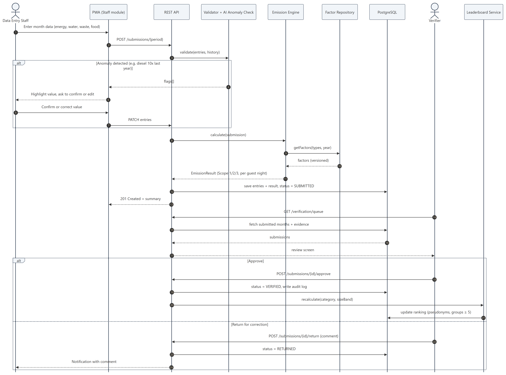
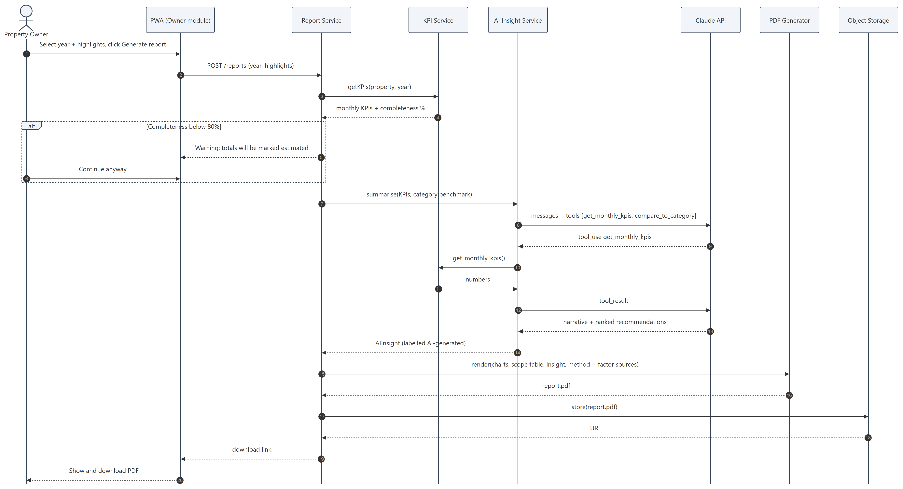

<div align="center">


# Project Arrow

### Greenhouse gas emission monitoring, analytics and benchmarking for Sri Lankan tourist accommodation


**From one Excel workbook per hotel → one platform for the whole sector.**

</div>

---

## Why

Sri Lankan hotels and guest houses have no practical way to measure the carbon footprint of their daily operations. The only tool in use today is the **TTVC Resource Efficiency Excel workbook**. It runs on macros and needs bills converted to megajoules and tonnes by hand. Its emission factors are for other countries, and it holds one property per file, so there is no national picture and no fair comparison.

**Project Arrow** turns that spreadsheet into a role-based web platform. Properties enter what is printed on their bills: litres, LPG cylinders, CEB units, m³, kg. The platform does the rest:

- converts entries to **kg CO₂e per guest night** across **GHG Protocol Scopes 1, 2 and 3**, using **versioned Sri Lankan emission factors**
- checks each month against evidence before it counts
- ranks properties **anonymously**, only against others of the same SLTDA category and size
- explains results and suggests **costed reduction actions** with AI
- shares consented, anonymised data with **government and UN** researchers (PDPA No. 9 of 2022)

Registered **and** non-registered properties follow the same flow.

## The team

Each member owns one user role end-to-end: screens, API routes, tests and documentation. Everything sits on a shared core that is frozen as a contract in Week 3.

| | Member | Role module | Shared-core responsibility |
|:-:|---|---|---|
| 🏨 | **Ronith Rashmikara** | R1 · Property Owner | AI service (insights, recommendations, chat) |
| 📝 | **Sithum Nimhan** | R2 · Data Entry Staff | Database schema and API contract |
| ✅ | **Savinthi Minaya** | R3 · Sustainability Verifier | Pseudonymisation and leaderboard service |
| 📊 | **Akarsha Sirisena** | R4 · Government / UN Analyst | UI kit and charts |
| ⚙️ | **Nadeera Prabhash** | R5 · System Administrator | Emission engine, factor library, auth and RBAC |

**Supervisor:** Ms. Githmi De Silva · **Institute:** Lanka Nippon BizTech Institute, Department of Computing

## What we're building

<div align="center">

<br><sub>Low-fidelity wireframes from the proposal</sub>
</div>

<br>

<table>
<tr>
<td width="50%" valign="top">

#### 🏨 Property Owner
- Register with SLTDA category, rooms, district, seasonal staffing
- Dashboard: kg CO₂e per guest night, by scope and source
- PDF reports, year-on-year and seasonal analysis
- Reduction targets with forecasting
- **What-if simulator** (switch fuel, add solar → CO₂e and LKR saved)
- AI insights and an *ask your data* chat
- Multi-property support

</td>
<td width="50%" valign="top">

#### 📝 Data Entry Staff
- Monthly occupancy, energy, water, waste and food purchases
- Everyday units, weekly → monthly roll-up
- **AI bill scanning** (photo → values to confirm)
- Inline validation, anomaly warnings, auto-saved drafts
- "Same as last month" quick-fill, monthly reminders

</td>
</tr>
<tr>
<td valign="top">

#### ✅ Sustainability Verifier
- Verification queue with bills and evidence side by side
- AI anomaly flags, approve / reject / request correction
- Only verified months reach the leaderboard
- Badges with a **QR eco-profile**, certification readiness checklist

</td>
<td valign="top">

#### 📊 Government / UN Analyst
- National dashboards by district, category and season
- Anonymised dataset export and open-data API
- **AI national baseline report**
- Never sees names or contacts. Groups under 5 are hidden

</td>
</tr>
<tr>
<td colspan="2" valign="top">

#### ⚙️ System Administrator
Approve properties, manage users and roles, **versioned emission-factor library with a change-impact preview**, Terms & Conditions versions, legacy Excel import, leaderboard rules and the audit log.

</td>
</tr>
</table>

## How it fits together

<div align="center">

</div>

<details>
<summary><b>System flow</b></summary>
<br>
<div align="center"></div>
</details>

<details>
<summary><b>Architecture</b></summary>
<br>

</details>

<details>
<summary><b>Data model (30 tables in three views)</b></summary>
<br>



</details>

<details>
<summary><b>Class and sequence diagrams</b></summary>
<br>



</details>

## Emission engine

```
activity (bill units)  ──►  base unit (kWh, L, kg, m³)  ──►  × emission factor (version in force)  ──►  kg CO₂e
                                                                                                     │
                                                       ÷ guest nights  ◄─────────────────────────────┘
```

| Scope | Sources |
|---|---|
| **1** · direct | Petrol, diesel, kerosene, LPG (37.5 / 12.5 / 5 / 2.3 kg cylinders), generator fuel, biogas / firewood |
| **2** · purchased electricity | Grid kWh × Sri Lanka grid factor for that year. Solar reported as avoided emissions |
| **3** · indirect | Food purchases (30 categories), waste by disposal route, water supply / treatment, outsourced laundry |

Every result stores the factor version it was calculated with, so old reports stay reproducible when factors change.

## Tech stack

| Layer | Choice |
|---|---|
| Frontend | React + Vite **PWA**, Tailwind CSS, Recharts |
| Mobile | Capacitor (Android APK) |
| Backend | Supabase (Auth, storage) or Node.js REST API, with an OpenAPI contract |
| Database | PostgreSQL with row-level security |
| AI | Claude API with tool use: insights, anomalies, bill OCR, reports |
| Reports | react-pdf |
| Process | Scrum, 2-week sprints, MoSCoW, GitHub Projects |

## Roadmap

<div align="center">

| Week | Milestone |
|:-:|---|
| 1–2 | Requirements, client workbook analysis, proposal ✅ |
| 3 | Shared core: schema, API contract, auth, UI kit, then **contract freeze** |
| 4–5 | **Sprint 1**: each member builds their role's main screens on the core |
| 6–7 | **Sprint 2**: Sri Lankan factors, engine tests vs Excel, submit → verify flow, dashboards · *client demo 1* |
| 8–9 | **Sprint 3**: leaderboard + pseudonyms, PDF reports, AI insights / anomalies, analyst export |
| 10–11 | **Sprint 4**: Excel import, food purchases, AI recommendations, forecast, simulator, bill OCR, badges · *client demo 2* |
| 12 | Usability testing with real guest houses, accessibility audit, fixes |
| 13 | Documentation, free-tier deployment, handover, final demo |

</div>

**Success criteria:** the engine matches the client workbook within ±1% on test data, at least 3 real pilot properties take part, and the System Usability Scale score is ≥ 70.

## Repository

```
project-arrow/
├── assets/          README art (hero.gif, wireframes.gif)
├── docs/
│   ├── PLAN.md      full project plan: roles, features, risks, questions
│   ├── diagrams/    use case, flow, architecture, class, ER, sequence
│   └── wireframes/  low-fidelity screens for all five roles
└── tools/           scripts that build the README assets
```

Application code will be added in the sprints.

## Privacy

- Property names and contacts are **never published**. Public rankings use pseudonyms.
- Peer groups with fewer than **5** properties are suppressed, and at least 80% data completeness is required to rank.
- Research sharing is **opt-in** and versioned under the Sri Lanka **PDPA No. 9 of 2022**.
- AI text is advisory and only explains numbers produced by the engine.

---

<div align="center">
<sub>
📝 <b>This is the initial README and is subject to change</b> as the project progresses.<br>
Lanka Nippon BizTech Institute · B.Sc. (Hons) Software Engineering · PRO310130 · 2026
</sub>
</div>
