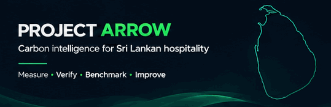
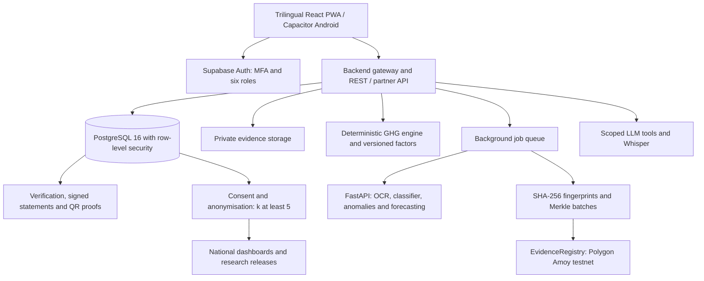

<div align="center">



# Project Arrow

### An AI-driven Digital MRV Platform
#### Measuring, Reporting & Verifying Carbon for Sri Lankan Tourist Accommodation


**Measure. Verify. Benchmark. Reduce.**

Six user roles · Five AI services · Evidence-backed carbon reporting

</div>

---

## Overview

**Project Arrow** is a proposed digital **Measurement, Reporting & Verification (MRV)** platform for Sri Lankan hotels and guest houses. It brings bill capture, GHG Protocol calculations, independent verification, private benchmarking and reduction planning into one offline-first platform.

The client's current workflow relies on paper bills and the TTVC Resource Efficiency workbook, a 30-sheet macro-based Excel tool. The proposal identifies manual retyping, handwritten figures, non-local emission factors, limited evidence traceability and fragmented reporting as the problems to solve.

Arrow's intended workflow is simple:

**Capture → Calculate → Verify → Act → Share**

> **Scope and status:** This README reflects the final proposal presentation supplied in November 2026. Features, technology choices and acceptance criteria below describe the planned full system, not a claim that every capability is implemented or every test has passed. The presentation describes a working prototype, but its results have not been independently revalidated here.

## Scope at a glance

| Area | Planned scope |
|---|---|
| Users | Six roles across hotel operations, verification, administration, policy and research |
| Delivery | Offline-first PWA and Android build from one React codebase |
| Languages | Sinhala, Tamil and English |
| Carbon accounting | GHG Protocol Scopes 1, 2 and selected Scope 3 sources, with versioned Sri Lankan factors |
| AI | Handwriting OCR, emission-factor classification, anomaly detection, forecasting and a voice assistant |
| Trust | SHA-256 evidence fingerprints, Merkle batching, testnet blockchain anchoring and QR proofs |
| Outputs | Private benchmarks, Green Certification, annual GHG reports, guest receipts and policy reports |
| Research | Consent-controlled access, data-use agreements and anonymised dataset releases |
| Delivery plan | Six two-week sprints, 4 November 2026 to 25 January 2027 |
| Pilot | Target of 3–5 hotels, with planned go-live on 22 January 2027 |

## Six user roles

| Role | User | Main capabilities |
|---|---|---|
| **R1 · Admin** | Client organisation | Approve hotels, manage users and MFA, maintain factors and peer-group rules, inspect audit logs and ledger checks |
| **R2 · Owner / GM** | Hotel owner or manager | View emissions and private rank, approve monthly submissions, forecast emissions, plan savings and generate reports |
| **R3 · Representative** | Front office or accounts staff | Capture bills, confirm extracted figures, enter monthly activity data and sync offline drafts |
| **R4 · Verifier** | Accredited consultant | Review risk-sorted submissions, check evidence and hashes, resolve queries, issue signed statements and certification |
| **R5 · Policy Analyst** | SLTDA, ministry or UNEP users | Explore national dashboards and GIS maps, model 2030 pathways and prepare policy reports |
| **R6 · Researcher** | University or NGO users | Request access, accept a data-use agreement, query anonymised data and download approved releases |

## What we're building

### Bill capture and monthly reporting

- Camera capture with cropping, de-skewing, blur and glare checks.
- Printed and handwritten digit recognition using **PaddleOCR + TrOCR**.
- Human confirmation of extracted values, with low-confidence digits highlighted. No unconfirmed OCR value enters the reporting database.
- Offline-first capture and synchronisation, email bill ingestion and meter readings.
- LPG entry, TTVC Excel import and Scope 3 capture for food, laundry, waste haulage and guest transport.
- Database schema, analytics warehouse and a documented REST + partner API.

### Carbon engine and factor library

- Deterministic GHG Protocol calculations with everyday bill units converted to the required base units.
- Versioned Sri Lankan emission factors, with official factors subject to client confirmation.
- Emission-factor suggestions from a classifier, rather than opaque AI-generated calculations.
- Scope and source breakdowns, total kg CO₂e and emissions per guest night.
- Versioned records and factor references so results remain traceable when inputs or factors change.
- Trust labels on values: **Verified**, **Evidence-backed** or **Self-declared**. Incomplete source data must be identified as estimated rather than presented as fully verified.

| Scope | Included sources |
|---|---|
| **1 · Direct emissions** | On-site fuel use, including LPG and generator fuel |
| **2 · Purchased electricity** | Purchased electricity using the applicable Sri Lankan grid factor |
| **3 · Selected indirect emissions** | Food, outsourced laundry, waste haulage and guest transport |

```text
Activity in bill units → Base-unit conversion → Versioned emission factor → kg CO₂e
                                                                          ↓
                                                               ÷ guest nights
```

### Verification, evidence and certification

- Risk-sorted verification workspace with evidence alongside reported values.
- **Isolation Forest** anomaly flags and duplicate-bill detection using image hashing.
- SHA-256 evidence fingerprints and Merkle batches anchored nightly through an **EvidenceRegistry** smart contract on **Polygon Amoy testnet**.
- Hash and proof checks, query threads, verifier audit trails and digitally signed statements.
- Public QR verification portal with privacy-controlled proofs.
- Project **Green Certification** levels: Bronze, Silver and Gold.
- Normalised private leaderboard. Owners see their own rank, not identifiable competitor records.

> Blockchain anchoring is intended to make subsequent changes detectable. It does not prove that a bill was truthful at capture, and does not replace human verification or constitute an ISO-certified audit. Only hashes and Merkle roots belong on chain, never bills or hotel data.

### Owner forecasting and savings

- Owner command centre with emissions by scope, source and guest night.
- **LightGBM** forecasts using occupancy and seasonality.
- Forecast-powered what-if scenarios, savings library and payback calculator.
- Carbon budgets, reduction targets and target pathways.
- Monthly sign-off workflow and annual GHG inventory PDF.
- Guest carbon receipt with a per-stay QR code.
- Model serving and planned nightly retraining.

### Policy, research and the voice assistant

- National dashboards by district, segment and trend, plus a GIS emissions map.
- National 2030 pathway tool and automated policy report builder.
- **LLM + Whisper** assistant in Sinhala, Tamil and English, accessing data only through scoped tools.
- Consent management and a consent ledger.
- Separate research access requests, data-use agreements, data catalogue and dataset releases.
- Privacy-safe aggregate queries and downloads with **k ≥ 5** anonymity, re-identification testing and dataset-hash citations.

**AI is advisory. Reported carbon-accounting figures come from the GHG engine, not an LLM. Forecasts are labelled predictions, not verified historical emissions.**

## Five AI services

| Service | Owner | Proposed approach | Evaluation |
|---|---|---|---|
| **Read**: handwriting OCR | Sithum | PaddleOCR + TrOCR, with human confirmation | Field accuracy on 200+ real bills, split by printed and handwritten fields |
| **File**: factor classifier | Nadeera | Sentence embeddings mapping bill lines to categories and factors | Accuracy on labelled bill lines |
| **Check**: anomaly detection | Savinthi | Isolation Forest and verifier review | Precision and recall on labelled data |
| **Predict**: emissions forecasting | Ronith | LightGBM with occupancy and seasonal inputs | MAPE against a seasonal-naive baseline |
| **Explain**: voice assistant | Akarsha | LLM + Whisper with scoped tools | Task success and checks against invented numbers |

## Team and ownership

Five developers share six role modules. Akarsha owns both policy and research, with each member also owning one AI service.

| Member | Module ownership | Platform responsibilities |
|---|---|---|
| **Ronith Rashmikara** | R2 Owner / GM | Forecasting, what-if and savings, budgets, sign-off, GHG reports, guest receipts, core backend gateway, job queue and MLOps |
| **Sithum Nimhan** | R3 Representative | OCR, camera and offline capture, email ingestion, meters, Scope 3 and LPG entry, TTVC import, PostgreSQL schema and partner API |
| **Savinthi Minaya** | R4 Verifier | Anomaly and duplicate detection, evidence hashes, Merkle batching, smart contract, signed statements, QR proofs, certification and private leaderboard |
| **Akarsha Sirisena** | R5 Policy Analyst + R6 Researcher | Voice assistant, national dashboards, GIS, 2030 pathways, policy reports, consent, anonymisation, research portal and accessible design system |
| **Nadeera Prabhash** | R1 Admin | GHG engine, factor library and classifier, onboarding, peer-group rules, MFA and RLS, audit logs, CI/CD, deployment, backups and monitoring |

**Supervisor:** Ms. Githmi De Silva<br>
**Client:** Mrs. MAMT Weerasinghe<br>
**Institute:** Lanka Nippon BizTech Institute, Department of Computing<br>
**Programme:** B.Sc. (Hons) Software Engineering · PRO310130 Industry-Based Software Development Group Project

## Proposed architecture



## Proposed technology stack

| Layer | Technology |
|---|---|
| Design | Figma and draw.io |
| Web | React, Vite, Tailwind CSS, Recharts, offline-first PWA |
| Android | Capacitor |
| Auth and storage | Supabase Auth, row-level security, storage and edge functions |
| AI / ML backend | Python and FastAPI |
| Database | PostgreSQL 16 |
| OCR | PaddleOCR + TrOCR |
| Forecasting / anomaly detection | LightGBM / Isolation Forest |
| Factor classification | Sentence embeddings |
| Assistant | LLM API, with Anthropic identified in the proposal, plus Whisper |
| Evidence ledger | Solidity, ethers and Polygon PoS Amoy testnet |
| Interfaces | REST and partner API with an OpenAPI contract |
| Delivery and operations | Vercel, Docker deployment, GitHub Actions, backups and monitoring |
| Testing and coordination | Vitest, Playwright, Lighthouse, GitHub Projects and two-week sprints |

## Security, privacy and integrity

- MFA, role-based access control and PostgreSQL row-level security across all six roles.
- Versioned records, append-only audit history and evidence fingerprints.
- Private hotel-level data and restricted leaderboard visibility.
- Consent-controlled research sharing, data-use agreements and releases with **k ≥ 5** anonymity.
- Re-identification tests and a six-role RLS test matrix.
- Privacy requirements framed around Sri Lanka's **PDPA No. 9 of 2022**, as specified in the proposal. This is a design objective, not a claim of independently certified legal compliance.
- No raw evidence, personal information or hotel records on the public blockchain.

## Boundaries and limitations

**Out of scope**

- Carbon-credit trading and certified ISO 14064 audits.
- Real-time IoT or smart-meter integration.
- Online payments and subscription billing.
- Direct SLTDA, CEB or NWSDB integrations. These are excluded by the proposal, which identifies the absence of suitable public APIs.
- Mainnet blockchain transactions or fees. Anchoring is testnet-only.
- Scope 3 categories beyond food, laundry, waste haulage and guest transport.

**Delivery dependencies**

- Client confirmation of official Sri Lankan emission factors, especially grid factors.
- Access to 200+ representative hotel bills for OCR evaluation.
- Sufficient labelled data for classifier and anomaly evaluation, and suitable historical data for forecasting.
- Missing hotel data must be labelled estimated, and free-tier storage and concurrency constrain the pilot.

## Delivery timeline

| Milestone | Proposal schedule |
|---|---|
| Development window | **4 November 2026 – 25 January 2027** |
| Iteration model | **Six two-week sprints** across five developers |
| Integration and pilot | January 2027, including **3–5 hotels** |
| Planned go-live | **22 January 2027** |
| Project completion | **25 January 2027** |

These dates are proposal targets, not evidence of completed delivery.

## Evaluation and acceptance targets

| Area | Planned acceptance check |
|---|---|
| Carbon engine | Within **±1%** of the client TTVC workbook on the same inputs, with factor assumptions documented |
| OCR | Field-accuracy report on **200+ real bills**, separating printed and handwritten cases |
| Evidence integrity | Detect **100% of edited records** in the defined tamper-test set |
| Performance | Dashboard **p95 ≤ 2 seconds** under load tests representing 500 hotels × five years of data and mobile 4G access |
| AI models | Forecasts beat a seasonal-naive baseline, with classifier accuracy and anomaly precision / recall reported |
| Security | Six-role RLS matrix and OWASP Top-10 checks |
| Privacy | k-anonymity and re-identification tests on research releases |
| Usability | New staff complete a monthly submission in **≤10 minutes**, with pilot **SUS ≥70** |
| Accessibility | **WCAG 2.2 AA** target, trilingual flows and **Lighthouse accessibility ≥90** |
| Pilot | Evaluation with **3–5 hotels** |

The presentation reports **27/27 prototype end-to-end tests**, a production Vite build and a visual review of 15 screens. Those are presentation-reported prototype results, not newly verified full-system outcomes. OCR, integrity, AI, security, privacy and pilot checks remain full-system evaluation work in the proposal.

## Repository and earlier design material

```text
project-arrow/
├── assets/          README animation and earlier wireframe animation
├── docs/
│   ├── PLAN.md      Earlier project plan
│   ├── diagrams/    Earlier architecture, data model and workflow diagrams
│   └── wireframes/  Earlier low-fidelity role screens
└── tools/           README asset-generation scripts
```

**Scope precedence:** The README now reflects the final proposal. Existing plans, diagrams and wireframes may still describe the earlier five-role scope and must be reconciled before being treated as implementation specifications. They are not presented here as current six-role architecture.

---

<div align="center">
<sub>
<b>Project Arrow · Capture → Calculate → Verify → Act → Share</b><br>
Lanka Nippon BizTech Institute · B.Sc. (Hons) Software Engineering · PRO310130 · 2026–2027
</sub>
</div>
